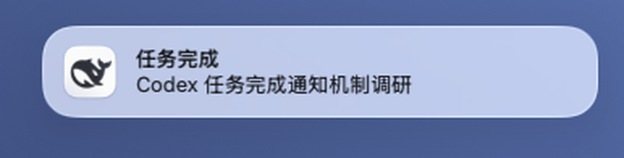
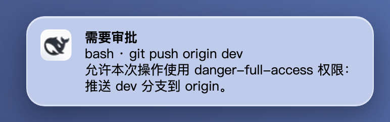

# dsh-notify · desktop notifications for DeepSeek Harness


A DeepSeek Harness (DSH) plugin bundle that raises a **native desktop notification** when:

- a session **finishes a turn** (`turn-complete`), and
- a tool call is **waiting for your approval** (`approval-requested`).

The default behavior mirrors Codex's `unfocused` mode: a notification is shown only while the
Harness window is **not focused**, so a run you are actively watching stays quiet. Switch the
condition to `always` if you want every event announced.

English | [中文](README.zh.md)

## What you get

Two native notifications, rendered by the Harness app and attributed to it:

| Turn complete | Approval needed |
|---|---|
|  |  |

- **Turn-complete alert** — a root session leaves `running` for `idle` while the Harness window is in the background; the banner carries the session title.
- **Approval alert** — a tool call is still waiting for your approval after the grace window, so requests that resolve themselves stay quiet; the banner names the session and the tool.
- **Focus-aware by default** (`condition: "unfocused"`), switchable to `always` in Settings.
- **Click to return** — clicking the notification focuses the Harness window.
- **Top-level sessions only** — subagents and teammates never raise a banner, so parallel work stays quiet.
- **Configurable in Settings** — the plugin row gets a settings page generated from its schema (enabled, condition, events, approval grace).

The banner copy follows the client locale; the screenshots above were captured on a Chinese-locale Harness and can be reproduced with the preview commands under [Verify an installation](#verify-an-installation).

## Requirements

- DeepSeek Harness `>= 0.2.1-rc.3` (desktop app or a Web GUI served on `127.0.0.1`).
- The operating system must allow notifications for the Harness app. On macOS the first
  notification asks for permission (System Settings → Notifications → DeepSeek Harness).

## Install

The package is published on npm as
[`@hmydk/dsh-notify`](https://www.npmjs.com/package/@hmydk/dsh-notify).

**DeepSeek Harness Desktop** — no command line needed:

1. Open **Plugins** in the sidebar.
2. Choose **Add plugin** and enter `@hmydk/dsh-notify`.
3. Install it, then **Enable now** (the bundle is listed as `dsh-notify`).
4. Reload the window (Cmd/Ctrl+R) so the browser half is loaded.

**`dsh web` or another profile** — requires `pnpm` on `PATH`:

```sh
dsh plugin --profile web add @hmydk/dsh-notify
```

Restart `dsh web` and reload the page. The command installs the package and selects its bundle.

**From this checkout** (development): run `pnpm install --prod` here first, then

```sh
dsh plugin --profile web add link:/absolute/path/to/dsh-notify
```

`dsh plugin --profile web add github:HMYDK/dsh-notify` installs the current `main` branch instead.
The Desktop profile is owned by the Desktop app, so a plain `dsh plugin --profile desktop ...` is
rejected; Desktop users install through the **Plugins** page.

The bundle patch mounts one row (`dsh-notify`) with both halves: the Host half detects events and
streams them over a loopback route, the browser half shows the system notification. After
installation, reload the GUI page once so the browser half is loaded.

To uninstall, use **Remove** on the plugin's page in Desktop, or:

```sh
dsh plugin --profile web remove @hmydk/dsh-notify
```

## Configuration

The row's settings page is generated from the plugin's `Config` schema, so the fields are editable
in **Settings → Plugins → dsh-notify**; the bundle patch also pins the defaults:

| Field | Type | Default | Meaning |
|---|---|---|---|
| `enabled` | boolean | `true` | Master switch. |
| `condition` | `unfocused` \| `always` | `unfocused` | Notify only while the Harness window is unfocused, or always. |
| `events` | array of `turn-complete`, `approval-requested` | both | Event types that raise a notification. |
| `approvalGraceMs` | number (0–60000) | `2000` | Wait this long before alerting an approval request; requests that resolve automatically stay silent. |

## Verify an installation

The Host half exposes three loopback-only diagnostic endpoints on the Harness Web server
(use the port from the GUI URL, e.g. `http://127.0.0.1:53221`):

```sh
# 1. Is the Host half mounted? One `config` frame is printed, then the stream stays open.
curl -N http://127.0.0.1:53221/notify/events

# 2. Is the browser half connected? `clients` should be 1 while the GUI page is open.
curl -s http://127.0.0.1:53221/notify/status

# 3. Preview the two notification shapes (bypasses the focus condition).
curl -s "http://127.0.0.1:53221/notify/test?kind=turn-complete"
curl -s "http://127.0.0.1:53221/notify/test?kind=approval-requested"
```

`/notify/status` also reports `lastAck` — what the browser half did with the most recent event
(`shown`, `suppressed`, `filtered`, `disabled`, `unsupported`, `failed`, `clicked`). This makes the
whole delivery path observable without a debugger.

## How it works

```
Host process                                   Browser page
┌──────────────────────────────┐                ┌──────────────────────────────┐
│ agent/status  running→idle   │   SSE          │ EventSource /notify/events   │
│ approval/request (+grace)    │ ─────────────▶ │ focus condition              │
│ /notify/events  (stream)     │  `notify`      │ new Notification(title, body)│
│ /notify/status  /notify/test │ ◀───────────── │ POST /notify/ack             │
│ /notify/ack                  │   `config` / ack                             │
└──────────────────────────────┘                └──────────────────────────────┘
```

- **Turn completion** is a root agent's `agent/status` transition `running → idle`. Subagents,
  teammates, and other child agents are intentionally silent.
- **Approval requests** listen on the `approval/request` waterfall and return `next()` unchanged, so
  the plugin never affects the decision. A grace timer (`approvalGraceMs`) keeps auto-resolved
  requests silent.
- The browser half owns the focus condition (`document.visibilityState` + `document.hasFocus()`) and
  the notification itself, so the alert is attributed to the Harness app and clicking it focuses the
  window.

## Security and privacy

- All plugin routes are **loopback-only**: socket address, `Host` header, forwarded-header
  rejection, and same-origin marker checks. A paired remote device cannot read session titles
  through them.
- Nothing is sent to a third party; the browser half talks only to the local Host route.
- `notify/test` can only be reached from the local machine.

## Limitations

- The routes are loopback-only by design, so the Web GUI opened through remote access does not get
  notifications.
- One notification per open page/tab. Several tabs open at once each show their own banner.
- Only root sessions are announced; the plugin does not break down per teammate.
- `approvalGraceMs` is a heuristic: a request answered automatically after the grace window may
  still produce one banner.
- macOS attributes the banner to the Harness app; the app must be allowed in System Settings.

## Development

Plain ESM, no build step. `index.js` is the Host half (`apply` + `Config`), `client.js` is the
browser artifact in client-module form (`window.__ModuleLoader__.load({ id, factory })`),
`cordis.patch.yml` inserts the row, and `locale/*.json` supply the Plugin Manager title and
description. After editing either half, reinstall/restart so the Host half reloads; the browser half
reloads with the page.

When you install from a local checkout with `link:`, Node resolves the plugin's own dependency from
the checkout, not from the profile. Run `pnpm install --prod` (or `npm install --omit=dev`) once in
this directory so `@deepseek-ai/schemastery` exists under `node_modules`; npm-published installs
resolve it automatically and need no extra step.

## License

MIT
